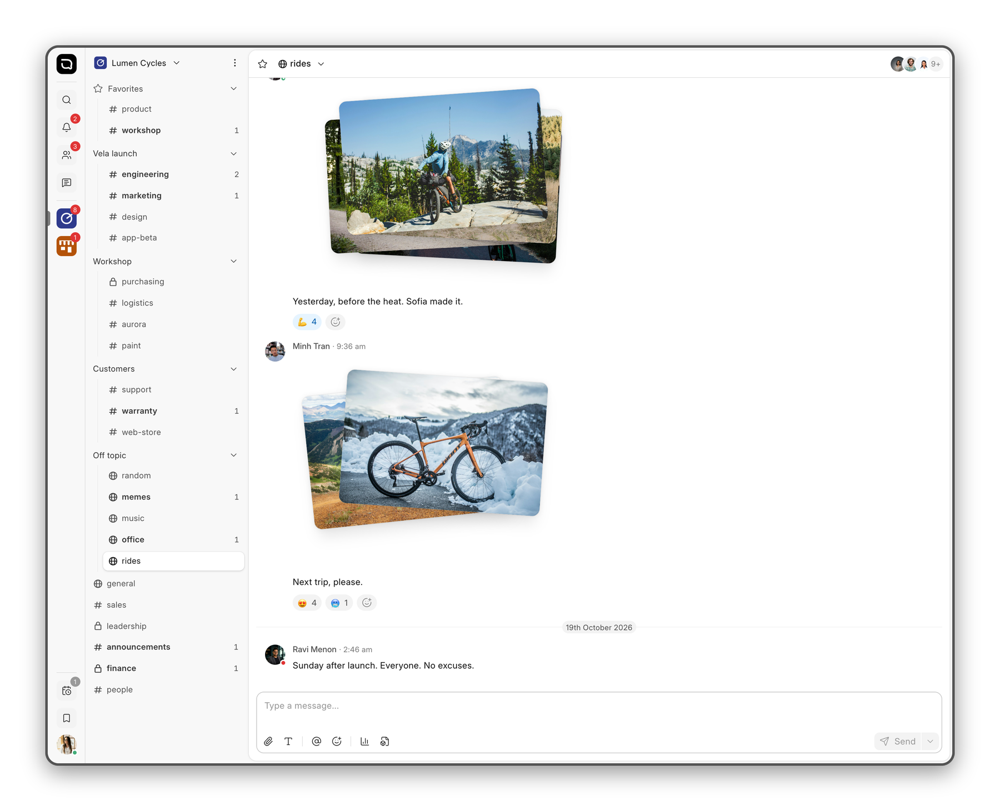
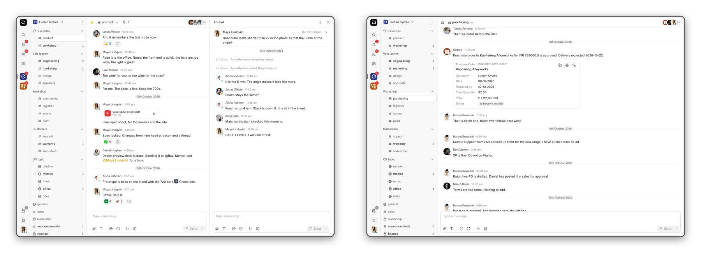
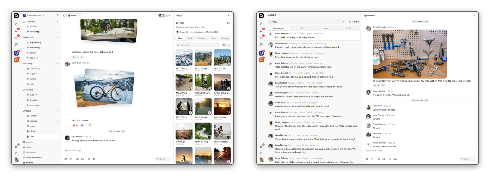

<div align="center" markdown="1">

<a href="https://frappe.io/product/raven">
    
</a>

<h1>Raven</h1>

**A simple chat app for teams**

[](https://github.com/frappe/raven/releases)
[](https://github.com/frappe/raven/actions/workflows/ci.yml)
[](LICENSE)

[Website](https://frappe.io/product/raven) - [Issues](https://github.com/frappe/raven/issues)

</div>

<picture>
	<source media="(prefers-color-scheme: dark)" srcset=".github/readme/raven-dark.png">
	
</picture>

<picture>
	<source media="(prefers-color-scheme: dark)" srcset=".github/readme/threads-documents-dark.png">
	
</picture>
<p align="center"><sub>Threads for side discussions &nbsp;&middot;&nbsp; Documents from any Frappe app, in the chat</sub></p>

<picture>
	<source media="(prefers-color-scheme: dark)" srcset=".github/readme/files-search-dark.png">
	
</picture>
<p align="center"><sub>Every file shared in a channel &nbsp;&middot;&nbsp; Search across channels</sub></p>

## Raven

Raven is an open-source chat app for teams, built on the [Frappe Framework](https://frappe.io/framework). It runs on your own Frappe site, so your messages stay in your database and nobody charges you per user.

It lives alongside ERPNext, HR, CRM and Helpdesk, and any document from any Frappe app can be part of the conversation.

### Key features

- **Channels and direct messages:** Public and private channels for teams, projects and topics, grouped into workspaces. Direct messages for everything else.
- **Threads:** Reply in the channel, or take a side discussion into a thread so it does not drown out everyone else.
- **Rich messages:** Formatting, mentions, code blocks, polls, emoji and custom reactions.
- **Files and previews:** Drop in photos, videos and documents. Links show a preview, and every file is listed per channel.
- **Search:** Find messages, files, links and people across every channel you are in.
- **Notifications:** Push notifications on the web and on your phone, with quiet hours and per-channel settings. Reminders bring a message back later, and scheduled messages go out at a set time.
- **Mobile:** iOS and Android apps, plus an installable web app, all on the same site.

### Works with your Frappe apps

- **Share a document:** Paste a link to any document on the site and Raven shows a card with its status and key fields.
- **Document notifications:** Post to a channel when a document is created, changed or submitted. Set the conditions and the message template without writing code.
- **Approve from the chat:** Approve, reject or send back a document without leaving the conversation.
- **Who is on leave:** Leave from Frappe HR shows next to a person's name.
- **Bots, webhooks and AI agents:** Bots that post and reply, incoming webhooks that post into channels, and agents backed by your own OpenAI or compatible provider.

### Under the hood

- [Frappe Framework](https://github.com/frappe/frappe): A full-stack web application framework.
- [Frappe React SDK](https://github.com/frappe/frappe-react-sdk): React hooks for auth, data fetching and realtime with a Frappe backend.

### Compatibility

| Raven branch | Frappe branch | Notes |
| :----------- | :------------ | :---- |
| main         | version-15 (15.111 or later), version-16 | Stable |
| develop      | version-15 (15.111 or later), version-16, develop | Development |

## Getting started

### Frappe Cloud

Install Raven on a site from the Frappe Cloud marketplace. Frappe Cloud takes care of hosting, upgrades, backups and support.

<div>
	<a href="https://cloud.frappe.io/marketplace/apps/raven" target="_blank">
		<picture>
			<source media="(prefers-color-scheme: dark)" srcset="https://frappe.io/files/try-on-fc-white.png">
			
		</picture>
	</a>
</div>

### Self hosting

[Pilot](https://github.com/frappe/pilot) is the recommended way to run Raven on your own server. It installs Frappe, manages sites and backups, and sets up production with nginx and TLS. Pilot needs Frappe v16 or later.

Install Pilot:

```bash
curl -fsSL https://raw.githubusercontent.com/frappe/pilot/develop/install.sh | bash
```

Create a bench and run the setup wizard. The first `start` prints the URL of the admin wizard.

```bash
pilot new main
pilot -b main start
```

Then add Raven and create a site:

```bash
pilot -b main get-app https://github.com/frappe/raven
pilot -b main new-site chat.example.com
pilot -b main install-app chat.example.com raven
```

Raven opens at `https://chat.example.com/raven`. See the Pilot [production guide](https://github.com/frappe/pilot/blob/develop/docs/production.md) for nginx, TLS and process managers.

If you already have a bench, install Raven the usual way:

```bash
bench get-app https://github.com/frappe/raven
bench --site your-site install-app raven
```

### Mobile apps

The iOS and Android apps connect to any site running Raven 3.1 or later. Enter the site address, sign in, and every channel is there, in sync with the web app.

<div>
	<a href="https://apps.apple.com/app/raven-mobile/id6741682327" target="_blank">
		
	</a>
	&nbsp;
	<a href="https://play.google.com/store/apps/details?id=raven.thecommit.company&hl=en_IN" target="_blank">
		
	</a>
</div>

## Development

Set up a bench with Pilot or [bench](https://docs.frappe.io/framework/user/en/installation), get the app and create a site as above, then turn on developer mode and skip CSRF checks for the site. The second setting is for local development only, since the Vite dev server has no CSRF token.

```bash
bench set-config -g developer_mode 1
bench --site raven.localhost set-config ignore_csrf 1
```

### Web app

The web app is a React single page app in `apps/web`. To work on it with hot reloading, add a `.env.local` file in `apps/web`:

```
VITE_SITE_NAME='raven.localhost'
VITE_SOCKET_PORT=9000
```

`VITE_SOCKET_PORT` is the socket.io port of your bench, usually the web port plus 1000. Then start the dev server from the app folder:

```bash
cd apps/raven
yarn
yarn dev
```

The app runs at `http://raven.localhost:8080` and proxies API calls to your site. Run `yarn` from the repository root only, not from `apps/web`.

## Contributing

- [GitHub Issues](https://github.com/frappe/raven/issues): Bug reports. Include steps to reproduce, screenshots and any console or server errors.
- [Report security vulnerabilities](https://frappe.io/security)
- [Translations](https://crowdin.com/project/frappe)

## License

[AGPLv3](LICENSE)

<br>
<br>
<div align="center" style="padding-top: 1rem; padding-bottom: 1rem; display: flex; justify-content:center;">
	<a href="https://frappe.io" target="_blank">
		<picture>
			<source media="(prefers-color-scheme: dark)" srcset="https://frappe.io/files/Frappe-white.png">
			
		</picture>
	</a>
</div>
